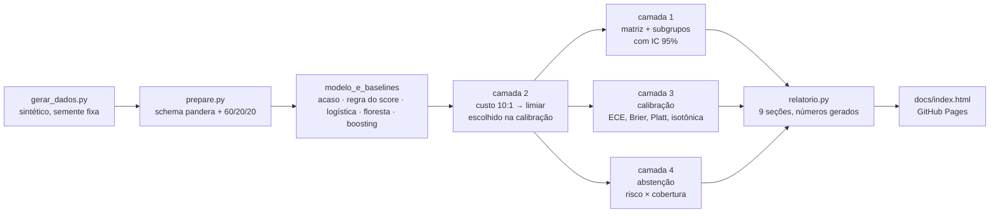
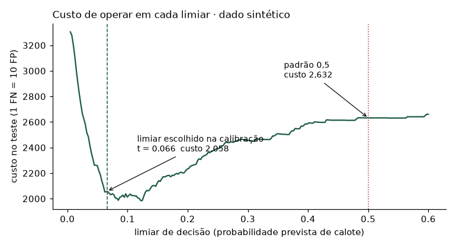
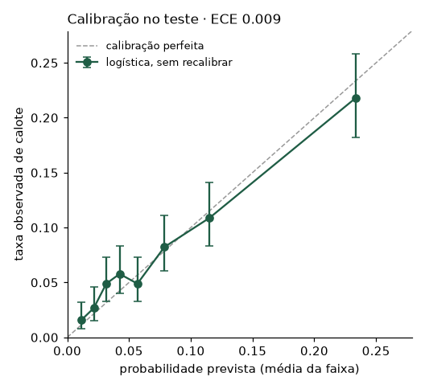
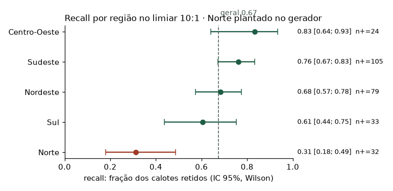

# Relatório de Confiança: um modelo de crédito avaliado em quatro camadas

Treinar um modelo de inadimplência é rápido. O trabalho maior é responder a alguém de
negócio se ele pode ir para produção. Este repositório avalia um modelo de crédito em
quatro camadas: que erros ele comete, quanto cada erro custa, se a probabilidade que ele dá
é confiável e se ele reconhece quando está em dúvida. O resultado é um relatório de 9 seções
gerado por script, com uma recomendação no final.

Workshop da Residência em IA, feito em dupla; este repositório é a minha reconstrução com
dado sintético. Autor: Matheus Rosa.

Relatório completo: [`outputs/09-relatorio-de-confianca.md`](outputs/09-relatorio-de-confianca.md) · [versão HTML com figuras](https://matheushpr94.github.io/relatorio-de-confianca-credito/)

> **Todos os números deste README vêm de dado SINTÉTICO** (`src/gerar_dados.py`, semente
> fixa, 18.000 solicitações, 7,6% de inadimplência). O efeito na região Norte foi
> **plantado** no gerador; o ponto é mostrar o método encontrando-o. Nada aqui descreve
> um mercado real.

## A decisão: piloto restrito

| | |
|---|---|
| **Recomendação** | **Piloto restrito**, com uso limitado e acompanhamento |
| **Por quê** | o modelo ordena risco 3,1x acima do acaso (AUPRC 0,239 contra piso 0,076, no teste) e chega calibrado, mas **no Norte retém 31% dos calotes contra 67% no agregado**, e o intervalo de 95% do Norte [0,18; 0,49] não alcança o geral |
| **O que destrava** | explicar o Norte; saber como a amostra foi montada (só há quem foi aprovado); alguém com mandato de negócio revisar a razão de custo |
| **O que não trava** | a razão de custo: o achado do Norte se sustenta em 6 de 8 cenários, de 5:1 a 200:1 |

> **No workshop original (dado real, não redistribuído aqui), o resultado foi o mesmo em
> forma:** AUPRC 0,29 contra piso 0,077; o Norte reteve 0,32 [0,19; 0,50] dos calotes
> contra 0,67 no agregado; recomendação **piloto restrito**. Só os agregados são citados:
> o arquivo foi entregue em aula, sem licença, e não entra neste repositório.

## Como funciona



**Três conjuntos, papéis separados.** O treino treina; a calibração escolhe o modelo, o
calibrador e o limiar; o teste só relata. Escolher o limiar no teste e relatar no teste
infla o resultado sem dar erro: aqui, medido, o recall de dentro passa o de fora em até
**11 pontos** (`outputs/04`).

## Matriz de custo e limiar

Um calote (FN) custa o principal; barrar um bom pagador (FP) custa a margem do contrato.
Recuperação de 10–40% do principal contra margem de 5–15% dá uma razão entre 4:1 e 18:1;
adotei **10:1** como premissa declarada e varri a faixa inteira ao lado.

| | Previsto inadimplente | Previsto pagador |
|---|---|---|
| **Real inadimplente** | VP = 184 | FN = 89 |
| **Real pagador** | FP = 1.168 | VN = 2.159 |

Limiar **t = 0,066**, escolhido na calibração. No padrão 0,5 o modelo pega **10 de 273**
calotes (recall 0,037) e custa **1,28x** mais. A acurácia no limiar operacional cai para
0,65, abaixo do piso de 0,92 de quem nunca acusa ninguém, e é por isso que ela não entra
na decisão.



| 1 FN vale | limiar | recall | pessoas negadas |
|---|---|---|---|
| 5 FP | 0,193 | 0,256 | 6,8% |
| **10 FP** | **0,066** | **0,674** | **37,6%** |
| 20 FP | 0,056 | 0,714 | 44,3% |
| 50 FP | 0,025 | 0,941 | 76,7% |

## A régua: uma coluna, sem treino

O acaso é piso obrigatório, mas não basta. O degrau que importa é a heurística que
qualquer analista faria: **ordenar só pelo `score_bureau`**. AUPRC na calibração:

| Candidato | AUPRC | × o piso | AUPRC no próprio treino |
|---|---|---|---|
| acaso | 0,076 | 1,0x | — |
| regra de uma coluna (score) | 0,205 | 2,7x | — |
| **regressão logística** | **0,287** | **3,8x** | 0,249 |
| Random Forest | 0,242 | 3,2x | **1,000** |
| HistGradientBoosting | 0,242 | 3,2x | 0,562 |

A modelagem acrescenta +0,082 de AUPRC sobre essa regra. Comparado só com o acaso, o
"3,8x" pareceria um ganho bem maior do que é.

**Por que logística.** Ela ganha dos dois modelos de árvore aqui e é a única que explica
uma negativa de crédito coeficiente por coeficiente. A floresta **decora**: AUPRC 1,000 no
treino e 0,242 fora dele. Desbalanceamento se resolve no limiar, não no treino: sem
`class_weight` nem SMOTE, porque reponderar desloca a probabilidade que a camada 3 mede.

## Calibração

ECE **0,009**, Brier 0,0648 contra piso 0,0701. A maior diferença entre previsto e
observado, em 8 faixas de mesma população, é 0,017. Platt e isotônica foram testadas e
**pioraram** o ECE (0,0135 e 0,0102), então nenhuma correção foi aplicada, por medição. O
limiar foi recalculado para cada versão e a operação não muda.

Um ECE baixo, sozinho, não prova muito: um modelo que devolvesse 7,6% para todo mundo também
teria ECE zero.



## Subgrupos, com intervalo de confiança

Recall no limiar 10:1, IC 95% de Wilson. Alerta **só** quando o intervalo inteiro do grupo
fica abaixo do recall geral; intervalo largo vira "incerto", não "pior".

| Região | n | Calotes | Recall | IC 95% | Alerta |
|---|---|---|---|---|---|
| Centro-Oeste | 275 | 24 | 0,833 | [0,641; 0,933] | |
| Nordeste | 904 | 79 | 0,684 | [0,575; 0,776] | |
| **Norte** | 382 | 32 | **0,312** | **[0,180; 0,486]** | **pior** |
| Sudeste | 1.541 | 105 | 0,762 | [0,672; 0,833] | |
| Sul | 498 | 33 | 0,606 | [0,437; 0,753] | incerto |
| **geral** | 3.600 | 273 | 0,674 | [0,616; 0,727] | |



- **A taxa de calote no Norte é parecida com a geral** (7,4% contra 7,6% no arquivo). Lá o
  modelo tem menos informação para separar quem paga de quem não paga, que é o efeito que
  o gerador de dados introduziu.
- **Medi todos os 10 recortes que o arquivo permite**, não o escolhido depois de ver o
  resultado, e em duas perguntas diferentes: o grupo é *protegido menos* (recall abaixo)
  ou *barrado mais* (taxa de negação acima)? Juntar as duas esconde a segunda
  (`outputs/08`).
- **O achado sobrevive à escolha do limiar**: real em 6 dos 8 cenários de custo; só some em
  1:1 e 2:1, onde o modelo não acha quase ninguém em lugar nenhum.

## Abstenção: não compensou

A margem de incerteza é medida até o **limiar operacional**, não até 0,5. As duas listas de
"10% mais incertos" têm **0 pessoas em comum**: usar 0,5 mandaria à revisão os casos de
maior risco, não os que estão em cima do muro.

| Cobertura | À revisão humana | Precisão | Recall |
|---|---|---|---|
| 100% | 0 | 0,136 | 0,674 |
| 90% | 360 | 0,143 | 0,685 |
| 80% | 720 | 0,154 | 0,701 |

Mandar 10% para revisão melhora a precisão em 0,7 ponto e o recall em 1,1, ao custo de 360
análises manuais, e não existe hoje uma equipe para fazer essa revisão. Por isso o modelo
opera sem abstenção.

## Limitações

- **Reject inference.** A amostra só tem quem foi aprovado (só há desfecho para crédito
  concedido). Em produção o modelo pontua também quem hoje é negado, e nunca viu essas
  pessoas.
- **Sem data.** Não há validação temporal, deriva nem safra; o sorteio aleatório é otimista
  se o mundo muda com o tempo.
- **Dado sintético.** Os números demonstram o método. O tamanho do efeito no Norte é
  consequência dos pesos do gerador; a semente e os pesos foram escolhidos vendo a saída
  (declarado em `gerar_dados.py`).
- **Um conjunto, três decisões.** A calibração escolheu modelo, calibrador e limiar; um
  quarto conjunto seria o certo.
- **A razão 10:1 é premissa**, não medida; a tabela de sensibilidade é a resposta para "e
  se estiver errada?".

## Como reproduzir

```bash
uv sync                                    # Python 3.11, versões travadas no uv.lock
uv run python src/rodar_tudo.py            # gera o dado, roda tudo, regrava outputs/ e docs/
uv run python src/rodar_tudo.py --conferir # roda de novo e só diz o que mudaria
```

Esperado no `--conferir`: `12 igual(is) | 0 mudou/mudaram | 0 falha(s)`. Roda em cerca de 1 minuto
num computador comum. `src/selftest_prepare.py` prova que o schema **falha** quando deve
(idade 17, score 1.000, canal inexistente, coluna renomeada).

### De onde vem cada número deste README

Todo número acima está em [`outputs/11-numeros-do-readme.txt`](outputs/11-numeros-do-readme.txt),
recalculado a cada rodada. Detalhe por camada:

| Número no README | Saída |
|---|---|
| AUPRC dos 5 candidatos, régua do score, floresta 1,000 no treino | `outputs/03-modelo-e-baselines.txt` |
| limiar 0,066, custo 1,28x, tabela de razões, otimismo de 11 pontos | `outputs/04-custo-e-limiar.txt` |
| matriz VP/FN/FP/VN, recall por região com IC, 6 de 8 cenários | `outputs/05-erro-e-subgrupos.txt` |
| ECE, Brier, Platt e isotônica | `outputs/06-calibracao.txt` |
| 0 pessoas em comum, tabela de cobertura | `outputs/07-incerteza-e-abstencao.txt` |
| 10 recortes, protege menos × barra mais | `outputs/08-subgrupos-candidatos.txt` |
| prevalência, taxa por região, efeito plantado | `outputs/00-dados-sinteticos.txt` |

## Estrutura

```
src/gerar_dados.py      dado sintético (schema de 15 colunas, efeito plantado no Norte)
src/prepare.py          schema pandera + a única divisão treino/calibração/teste
src/metricas.py         ECE, pisos, custo e varredura de limiar: uma definição só
src/modelo_e_baselines.py, camada_1..4_*.py, subgrupos_candidatos.py
src/relatorio.py        o relatório de 9 seções, gerado
src/figuras.py          os 3 PNG
src/rodar_tudo.py       roda tudo; --conferir para reprodutibilidade
outputs/                saídas de texto versionadas (diffáveis)
docs/                   relatório HTML + figuras (GitHub Pages)
```

Licença: MIT (código). O dado é gerado pelo próprio repositório.
